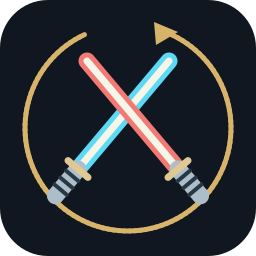

# SWTOR Recap

Windows app for SWTOR combat stats, session history, and monthly or yearly recaps. Reads combat logs and stores history on your PC. Works with Steam and alongside StarParse.

## Install

[Downloads](https://github.com/ASVPATM/swtor-recap/releases)

| Download | Setup |
| --- | --- |
| `SwtorRecap-0.3.0-Setup.exe` | Run the installer, then open **SWTOR Recap** from the Start menu. |
| `SwtorRecap-win-x64.zip` | Extract the entire ZIP and open **SwtorRecap.exe**. Keep the files together. |

Windows x64. The .NET runtime is included. No administrator access is needed. The test build is unsigned, so Windows may show a publisher or reputation warning.

1. In SWTOR, enable **Preferences → Combat Logging → Enable combat logging to file**.
2. Open Recap and launch SWTOR normally. The combat-log folder is detected automatically; change it in Settings if needed.
3. Play. Closing the dashboard leaves the tray tracker running. Finished sessions appear in History.

[Replace an older version](docs/GUIDE.md#replace-an-earlier-version) · [Setup and troubleshooting](docs/GUIDE.md)

## Counts

| Stat | What counts |
| --- | --- |
| Damage and healing | Your character's raw logged output. Healing includes self-heals, periodic effects, and overhealing. Effective amounts appear in recording details. |
| NPC kills | A recorded death after you dealt **more than 50% of the target's maximum health** in effective damage. Includes individual boss targets. You may die before the group finishes; the final blow can come from someone else. |
| Player deaths | Your character's logged deaths. |
| Combat time | Your logged combat intervals. |
| Game-open time | Observed time while SWTOR is running, including AFK time; excludes sleep and recording pauses. |
| Boss wins | Your participation in a supported encounter with victory evidence. |
| Activity clears | A supported final-boss defeat. |
| Full runs | All required supported encounters observed without a recording gap. |

Companion and party damage/healing are excluded from your totals. NPC kills exclude players, companions and known training dummies. Missing health or death evidence does not establish a kill. Individual boss kills and boss encounter wins are separate totals. Quest conversations, rewards, XP, loot, and official game kill credit are not tracked.

Known bosses with explicit death targets use shared counting rules across the catalog. Scripted endings without a verified rule appear as unconfirmed. Full-run coverage is narrower than final-boss clear coverage. [Supported rules and limits](docs/GUIDE.md#encounter-coverage)

## Updates and characters

Use **Settings → Check for updates → Download, install and reopen**. Close SWTOR first. Recap verifies the GitHub download and saves a history backup before installation. Updates use public stable releases; private previews need the supplied installer. Updating a portable copy creates a managed installation with a Start menu shortcut.

Switching characters keeps the same session while SWTOR stays open. Each character's combat stats stay separate. History and Recap show all characters by default; use the character filter for one character. Game-open time belongs to the session, not an individual character.

## Data

SWTOR writes `combat_*.txt`; Recap only reads them. Recap history, backups, and imported-log copies live in `%LOCALAPPDATA%\SwtorRecap`. There is no account, upload service, overlay, or game-memory access. Recap images hide character names by default.

## Build

Install the .NET SDK specified in `global.json` and Python 3, then run `python3 scripts/check.py` (`py scripts/check.py` on Windows). [Build and package commands](docs/GUIDE.md#build-from-source)

## License

[MIT](LICENSE). [Dependency notices](THIRD_PARTY_NOTICES.txt). Original project logo. Independent fan project; not affiliated with Lucasfilm, Electronic Arts, or Broadsword.
